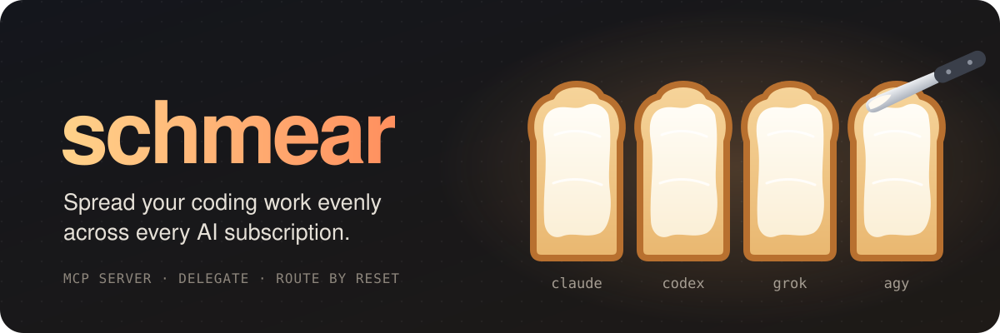

<p align="center">
  
</p>

<p align="center">
  <a href="https://github.com/kevin1chun/schmear/actions/workflows/ci.yml"></a>
  <a href="https://www.npmjs.com/package/schmear"></a>
  <a href="LICENSE"></a>
  <a href="https://buymeacoffee.com/kevin1chun"></a>
</p>

schmear is an MCP server that lets your coding agent hand subtasks to your AI subscriptions: Claude Code, Codex, Grok and Antigravity. Each task goes to the subscription with the most quota about to expire unused at its reset, on a model at least as strong as the task needs.

## Quickstart

```sh
npm i -g schmear --omit=optional
schmear init    # choose which CLIs may run tasks; registers schmear in each agent
```

Restart your agent and ask: *"Have another agent write tests for src/parse.ts."* Run `schmear usage` to see each subscription's quota and where the next task would go.

Needs Node 22.18+ on macOS or Linux and at least one of `claude`, `codex`, `grok` or `agy`, logged in.

## Why schmear

- **Your existing logins.** Workers are the CLIs you already use, over the [Agent Client Protocol](https://agentclientprotocol.com). No API keys required.
- **Nothing expires unused.** Tasks go to the subscription with the most quota left for the time left until its reset.
- **Never weaker than asked.** Each task names a minimum model tier.
- **Parallel.** One call runs up to 8 tasks at once.
- **Careful with money.** It reads usage without running a model, and skips any subscription it can't read or that's nearly out.

## Docs

[Guide](docs/guide.md) · [Safety](docs/safety.md) · [Design](docs/spec.md) · [Changelog](CHANGELOG.md) · [Contributing](CONTRIBUTING.md)

## Support

If schmear saves you quota, a coffee keeps it going:

<a href="https://buymeacoffee.com/kevin1chun"></a>

## License

[MIT](LICENSE). Usage readers are reimplemented from [CodexBar](https://github.com/steipete/CodexBar)'s provider docs; no CodexBar code is included.
